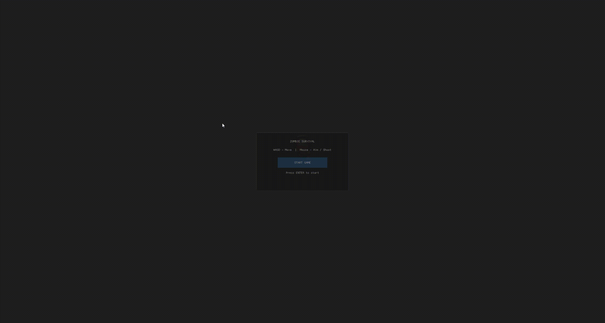

# Zombie Survival

**C++ / OpenGL 기반 3D 탑다운 좀비 슈팅 게임**

게임 엔진을 사용하지 않고 OpenGL을 기반으로 3D 렌더링과 게임플레이 시스템을 직접 구성한 개인 프로젝트입니다.

3D 그래픽스의 기본 동작 원리를 이해하고, 렌더링부터 캐릭터 제어, 충돌 판정, 전투 시스템까지 하나의 게임으로 연결하는 것을 목표로 개발했습니다.

## 1. Gameplay

### 시연 영상

[Gameplay video](https://youtu.be/XRe8apI6Ndc)



*WASD로 이동하고 마우스로 조준하여 몰려오는 좀비를 처치하는 생존형 슈팅 게임입니다.*

### 주요 기능

- **플레이어:** WASD 이동, 마우스 조준, 총기 발사
- **전투:** Raycast 기반 피격 판정, 체력 및 데미지 처리
- **좀비:** 플레이어 추적, 근접 공격, 지속적인 스폰
- **애니메이션:** 플레이어 이동·사격 및 좀비 애니메이션
- **이펙트:** 총구 화염, 탄환 궤적, 피격 효과 및 사운드
- **UI:** 플레이어 체력, 킬 카운트, 게임 시작 및 종료 화면

## 2. Tech Stack

| 구분 | 기술 |
|---|---|
| Language | C++17 |
| Graphics | OpenGL 3.3 Core |
| Window / Input | GLFW |
| OpenGL Loader | GLAD |
| Model Loading | Assimp |
| Audio | miniaudio |
| UI | Dear ImGui |
| Build | CMake, vcpkg |
| Development | Windows, Visual Studio / VS Code |

## 3. 주요 기술 구현

### 3.1. 자체 수학 라이브러리 및 3D 렌더링

외부 수학 라이브러리에 의존하지 않고 `Vec2`, `Vec3`, `Vec4`, `Mat4`, `Transform`을 구성했습니다.

- 벡터 및 행렬 연산 구현
- 이동, 회전, 크기 변환 행렬 구현
- Model / View / Projection 행렬을 이용한 3D 렌더링
- VAO, VBO, EBO 기반 메시 렌더링
- GLSL Shader를 통한 조명과 Material 처리

**학습한 내용**

3D 객체가 로컬 좌표계에서 월드, 뷰, 클립 공간으로 변환되어 화면에 출력되는 과정을 이해하고 구현했습니다.

### 3.2. 카메라 및 마우스 조준 시스템

플레이어를 따라가는 카메라를 구현하고, 마우스 화면 좌표를 월드 공간의 Ray로 변환하여 조준 방향을 계산했습니다.

**처리 흐름**

1. 마우스 화면 좌표 획득
2. 화면 좌표를 NDC로 변환
3. 역 View / Projection 변환을 통해 월드 공간 Ray 계산
4. Ray와 수평면의 교점 계산
5. 플레이어가 해당 위치를 바라보도록 회전

이를 통해 탑다운 시점에서도 마우스 위치에 따라 자유롭게 조준할 수 있도록 구현했습니다.

### 3.3. Raycast 기반 전투 시스템

총기 발사 시 진행 방향과 좀비의 충돌 영역을 검사하여 피격 대상을 결정합니다.

- XZ 평면에서 Ray와 원의 교차 판정 구현
- 사거리 내 가장 가까운 좀비 선택
- 총기 발사 간격 및 데미지 처리
- 피격·사망 판정과 시각 효과 연결

실제 피격 판정은 Hitscan 방식으로 즉시 수행하고, 탄환 궤적은 별도의 시각 효과로 표현했습니다.

### 3.4. 좀비 AI 및 스폰 시스템

좀비가 플레이어를 지속적으로 추적하고 일정 거리 이내에 접근하면 공격하도록 구현했습니다.

- 플레이어 위치를 목표로 이동
- 공격 범위 및 공격 쿨타임 관리
- 주기적인 좀비 생성
- 최대 활성 좀비 수 제한
- 체력 감소 및 사망 시 제거

### 3.5. Skeletal Animation 및 GPU Skinning

Assimp를 활용해 GLB 모델의 본, 정점 가중치, 애니메이션 데이터를 읽어 오고, GPU Skinning 방식으로 캐릭터 애니메이션을 출력하는 시스템을 통합했습니다.

**애니메이션 처리 구조**

`AnimatedModel → Skeleton / AnimationClip → Animator → GPU Skinning`

주요 구성 요소:

- `AnimatedModel`: 메시, 본, 애니메이션 데이터 로딩
- `SkeletonNode`: 계층 구조 관리
- `AnimationClip`: 키프레임 데이터 보관
- `Animator`: 키프레임 보간 및 본 변환 행렬 계산
- `AnimatedModelResource`: 모델 및 GPU 메시 데이터 공유
- `AnimatedCharacter`: 캐릭터별 애니메이션 상태 관리

해당 시스템은 **생성형 AI의 코드 생성 지원을 받아 구현**했습니다. 이후 기존 렌더링 파이프라인에 통합하고 플레이어와 좀비에 적용하여 동작을 검증했습니다.

본 계층 변환의 누적과 정점 가중치 기반 변형 등 스켈레탈 애니메이션의 기본 원리를 학습했으며, 세부 보간 및 행렬 계산 구현은 추가로 학습하고 있습니다.

## 4. Project Structure

```text
src/
├── main.cpp
├── Math/
│   ├── Vec2 / Vec3 / Vec4
│   ├── Mat4
│   └── Transform
├── Graphics/
│   ├── Shader
│   ├── Mesh
│   ├── Model
│   ├── Camera
│   └── Animation/
│       ├── AnimatedModel
│       ├── AnimatedMesh
│       ├── Skeleton
│       ├── AnimationClip
│       ├── Animator
│       ├── AnimatedModelResource
│       └── AnimatedCharacter
└── Game/
    ├── Game
    ├── Player
    ├── Zombie
    ├── Weapon
    ├── Collision
    ├── ZombieSpawner
    └── BulletEffects
```

*실제 저장소의 파일 구조에 맞게 수정할 예정입니다.*

## 5. 개발 과정에서 배운 점

이번 프로젝트를 통해 게임 엔진이 제공하는 기능들이 내부적으로 어떤 수학적·그래픽스적 처리 과정을 거쳐 구현되는지 경험할 수 있었습니다.

특히 좌표계 변환, 행렬 곱셈 순서, 카메라 Ray 생성, GPU 정점 데이터 전달 등에서 발생한 문제를 해결하며 OpenGL 렌더링 파이프라인에 대한 이해를 높였습니다.

또한 기능을 구현하면서 `main.cpp`에 집중되던 코드를 `Game`, `Model`, `AnimatedCharacter` 등으로 분리하고 각 클래스의 책임을 구분하는 경험을 했습니다.

## 6. AI 활용 범위

개발 과정에서 생성형 AI를 학습 및 코드 작성 보조 도구로 활용했습니다.

특히 Skeletal Animation과 GPU Skinning은 AI가 제안한 구현을 기반으로 프로젝트에 통합했습니다. 반면 프로젝트의 핵심 학습 목표였던 렌더링, 수학적 변환, 카메라 및 충돌 판정 등은 각 원리를 이해하고 검증하는 데 중점을 두었습니다.

AI가 제안한 코드에 대해서도 실제 빌드·실행을 통해 동작을 확인하고 프로젝트의 기존 구조에 맞춰 연결했습니다.

## 7. Build & Run

**Requirements**

- C++17 지원 컴파일러
- CMake
- vcpkg
- OpenGL 3.3 이상 지원 환경

```bash
cmake -S . -B build \
  -DCMAKE_TOOLCHAIN_FILE="경로/vcpkg/scripts/buildsystems/vcpkg.cmake"

cmake --build build --config Release
```

Windows 환경 기준이며, 실행 시 `shaders`, `assets` 디렉터리가 올바른 작업 디렉터리에 존재해야 합니다.

## 8. Future Improvements

- 자연스러운 애니메이션 블렌딩
- 다양한 적 행동 패턴
- 충돌 및 렌더링 최적화
- 게임플레이 밸런스 개선
